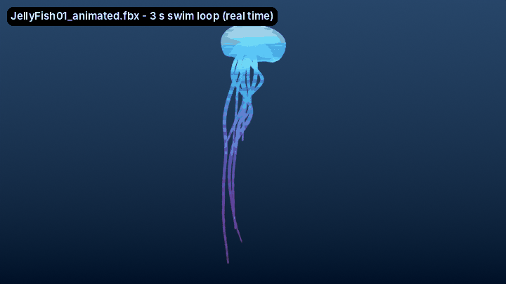

# Sunbeams + Hologram JellyFish: Horizon Worlds-ready models

Your two models (the animated sunbeams and the 3ds Max jellyfish), cleaned up, scaled, textured
and animated for import into the Meta Horizon Worlds desktop editor.



## What's in the box

```
horizon-3d-assets/
├── Sunbeams/
│   ├── animated/   Sunbeams_A/B/C_animated.fbx + Sunbeam_BA.png   (skinned, looping animation)
│   ├── static/     Sunbeams_A/B/C.fbx + Sunbeam_BA.png             (plain meshes)
│   └── alt-texture/Sunbeam_BA.png                                  (grainier "dusty light" variant)
├── JellyFish/
│   ├── animated/   JellyFish01-06_animated.fbx, Bubbles_animated.fbx + Jellyfish_BA.png, Bubble_BA.png
│   └── static/     JellyFish01-06.fbx, Bubbles.fbx + the same two textures
├── scripts/AssetMotion.ts   motion for the static versions (JellyFishSwim, SunbeamSway, BubbleDrift)
└── previews/                renders and GIFs of the exported files
```

| Asset | Size (m, W×D×H) | Triangles | Rig | Loop |
|---|---|---|---|---|
| Sunbeams_A | 5.1 × 4.6 × 6.0 | 9,600 | 30 bones | 599 frames @ 24 fps (25 s) |
| Sunbeams_B | 5.8 × 5.9 × 5.3 | 3,200 | 10 bones | 599 frames @ 24 fps (25 s) |
| Sunbeams_C | 11.0 × 11.7 × 4.3 | 13,440 | 42 bones | 599 frames @ 24 fps (25 s) |
| JellyFish01 | 0.4 × 0.3 × 1.2 | 3,552 | 7 bones | 72 frames (3.0 s) |
| JellyFish02 | 0.4 × 0.4 × 1.2 | 4,692 | 7 bones | 66 frames (2.75 s) |
| JellyFish03 | 0.4 × 0.4 × 1.6 | 3,780 | 7 bones | 78 frames (3.25 s) |
| JellyFish04 | 0.4 × 0.4 × 1.3 | 6,696 | 7 bones | 70 frames (2.9 s) |
| JellyFish05 | 0.4 × 0.4 × 1.3 | 6,292 | 7 bones | 84 frames (3.5 s) |
| JellyFish06 (baby) | 0.2 × 0.2 × 0.3 | 6,292 | 7 bones | 60 frames (2.5 s) |
| Bubbles | 3.5 × 2.2 × 1.8 | 8,344 (was 33,376) | 6 bones | 96 frames (4 s) |

## What was done

**Sunbeams**
- Split the one file into three assets (A, B, C), one per rig, each with its own single looping
  take. The original 600-frame animation ends exactly where it starts, so the loop is seamless.
- Fixed the scale: the clusters came in about 115 m tall. They're now about 6 m (A), with B and
  C in proportion. Each cluster is centered, with its base at the origin.
- **Texture rebuilt.** The original beam masks are deliberately faint, because each cluster
  stacks dozens of beam planes and the opacity adds up. I kept that design and combined the
  sunbeam color and the beam mask into one `Sunbeam_BA.png`: warm gold edges, whiter cores, and
  6% opacity per plane (higher made the clusters render as solid blobs). The mask was smoothed
  first, because the source only had about 10 grey levels and showed banding.
- Removed an unused all-white vertex-color layer.

**JellyFish**
- One asset per jellyfish, so they can be placed and timed independently, plus Bubbles.
- Fixed the 3ds Max units and the stray per-object scales. Every model now has its real size in
  meters, and its pivot sits at the bell rim (the bell above it, tentacles hanging below).
- **New UVs.** The originals were broken, with coordinates up to ±3000 on JellyFish06. Each
  jellyfish now has clean 0–1 UVs wrapped around its body, top to bottom.
- **New hologram texture,** `Jellyfish_BA.png`. The original look came from V-Ray procedural
  maps that no real-time engine can read. I rebuilt it from your HOLO-TEX01 scanlines and the
  V-Ray colors: a glowing cyan bell with a bright rim, tentacles fading from cyan to violet to
  pink, and horizontal hologram scanlines.
- **Animation built from scratch.** The FBX's animation take was empty, so nothing moved. Each
  jellyfish now has a 7-bone rig (body, bell, 5-bone tentacle chain) and a seamless swim loop:
  - the bell squeezes and relaxes
  - the body rises after each stroke and then sinks back
  - the tentacles trail in a lagging wave

  Each jellyfish has a slightly different loop length, so a school never moves in lockstep.
- **Bubbles** were reduced from 33k to 8.3k triangles. They're grouped into 6 clusters that bob
  and drift on a 4-second loop.

**Checks.** Every exported file was re-imported into a clean Blender scene and checked:
- correct real-world size
- one material, with its texture file sitting right next to the FBX
- all UVs within 0–1
- the animation moves, and the jump from the last frame back to the first is about one normal
  frame step, so the loops are seamless

## Importing into Horizon Worlds

1. In the desktop editor, open **Asset Library**, then **Add New**, then **3D Model**.
2. Select an FBX **together with its texture PNG(s)** from the same folder, e.g.
   `JellyFish01_animated.fbx` + `Jellyfish_BA.png`. Wait until all files are listed, then
   **Import**.
3. Materials are named with Horizon's convention, so the textures attach automatically:

   | Material in FBX | Texture | Horizon material type |
   |---|---|---|
   | `Sunbeam_Blend` | `Sunbeam_BA.png` | Unlit, alpha-blended (soft glowing light shaft) |
   | `Jellyfish_Blend` | `Jellyfish_BA.png` | Unlit, alpha-blended (hologram) |
   | `Bubble_Blend` | `Bubble_BA.png` | Unlit, alpha-blended |

   Textures are 8-bit RGBA PNGs at power-of-two sizes (1024 or 256), as Horizon requires.

### Animated or static: which to use

- **Try the `animated/` versions first.** They're standard skinned meshes, each with one looping
  take, named e.g. `JellyFish01_Swim` or `Sunbeams_A_Loop`. Horizon has recently documented FBX
  animation import, and creators are bringing in Blender animations this way. But I couldn't
  confirm the exact current rules (bone limits, how playback is started) from Meta's docs, which
  are blocked from my environment.
- **If the animation doesn't play, use the `static/` versions plus `scripts/AssetMotion.ts`.** It
  works with any Horizon build:
  1. Add the script.
  2. On each entity, set **Motion = Animated**.
  3. Attach `JellyFishSwim`, `SunbeamSway` or `BubbleDrift`.
  4. Every property has a sensible default. `phase = -1` randomizes each copy so they don't
     move in unison.

### Recreating the original jellyfish school

Offsets from JellyFish05, in meters (x right, y up, z forward). Treat these as a guide; if the
group looks mirrored, flip the sign of x.

| Asset | x | y | z |
|---|---|---|---|
| JellyFish05 | 0 | 0 | 0 |
| JellyFish03 | -0.10 | -0.38 | 0.58 |
| JellyFish04 | 0.38 | -0.53 | 0.48 |
| JellyFish02 | -0.65 | -0.73 | 0.59 |
| JellyFish01 | 0.21 | -0.78 | 1.14 |
| JellyFish06 | 0.16 | -0.90 | 0.85 |
| Bubbles | 0.68 | -1.68 | 0.83 |

## If something looks off

- **Texture missing after import:** the PNG wasn't selected in the same import as the FBX, or it
  was renamed. Names must match exactly (`Jellyfish_BA.png` for `Jellyfish_Blend`).
- **Want a different material type** (e.g. lit Transparent instead of Unlit Blend, or a
  different tag that your build expects)? Tell me; it's a one-line change and a re-export.
- **Size:** everything is in real meters. Scale the entity in Horizon if you want giant
  jellyfish or a smaller light shaft.
- **Sunbeams too faint or too strong:** use `alt-texture/Sunbeam_BA.png`, or ask for a different
  opacity. The texture is generated, so it's a quick change.

## Rebuilding (optional)

`tools/` holds the exact pipeline that produced these files. It needs Blender 5 (or the `bpy` 5.0
Python module) plus Pillow and NumPy.
1. `python3 tools/texgen.py <inputs> <tex>` makes the textures.
2. Run `tools/prep.py` inside Blender's Python to split, scale, re-UV, rig, animate and export
   everything.
3. `tools/verify.py` re-imports every FBX and checks it.

Change a value (target sizes, loop lengths, sunbeam opacity) and re-run to regenerate everything.
