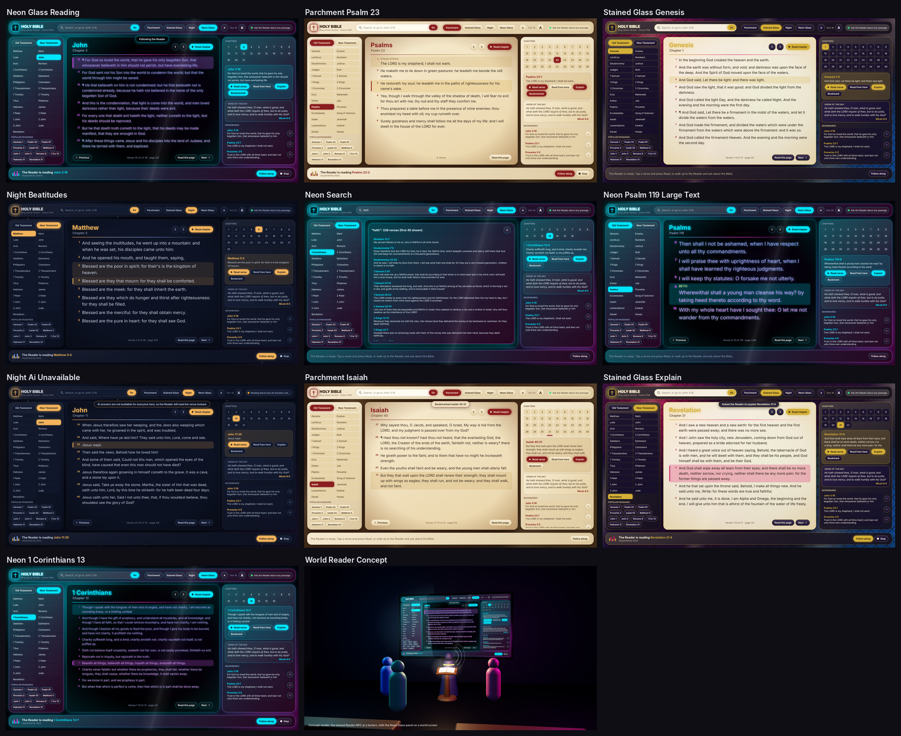

# King James Bible Reader for Meta Horizon Worlds (Noesis UI + AI NPC)

This is a Bible panel for Horizon Worlds. Each player gets their own panel and can open any book,
chapter or verse of the King James Version. One shared **Reader** NPC reads passages aloud for
everyone, word for word, and answers spoken questions about the Bible.



> The previews are **mockups, not Horizon screenshots**. Each one is an HTML replica of
> `BibleReader.xaml`, filled with real output from the scripts (pages, highlights, search
> results, queue state) run headless. The in-world image is a three.js concept render.

## Features

- **The whole KJV:** all 66 books and 31,102 verses, from the Oxford 1769 text.
  - Psalm titles appear above verse 1 (e.g. "A Psalm of David, when he fled from Absalom his son.").
  - Psalm 119's Hebrew-letter headings (ALEPH, BETH, ...) appear above their sections.
  - Paragraph marks (¶) are kept.
- **Navigation:** Old/New Testament tabs, a book list, a chapter grid, and previous/next
  chapter buttons that wrap from Revelation back to Genesis. Chapters are shown a page at a
  time, sized so each page fits without scrolling (comfortable on Quest).
- **Search box:** type words (`faith`, `love one another`) to search every verse, or type a
  reference to jump straight there. Accepted forms include `John 3:16`, `jn 3 16`, `1 Cor 13`,
  `I Samuel 17:4-11`, `psalm 23` and `rev 21:4`.
- **Popular passages, verse of the day, and bookmarks.** Bookmarks are kept between visits if
  you add the persistent variable described below.
- **The shared Reader:**
  - Reads exact text: the selected verse, from a verse to the end of the chapter, a page, or
    a whole chapter.
  - Requests from all players go into one fair queue: at most 2 waiting per player and 6
    total, adjustable.
  - Every panel shows "The Reader is reading John 3:16, requested by Grace", with a live
    equalizer, and the verse being spoken is highlighted.
  - **Follow along** keeps your page turning with the Reader.
  - **Stop** cuts it short.
  - For speech only, "LORD" is said as "Lord" so text-to-speech doesn't spell it out letter by
    letter. The text on screen is never changed.
- **Bible Q&A:**
  - Players walk up to the Reader and ask questions out loud.
  - The AI always gets the exact KJV text of the passage being read or looked at, plus strict
    rules: be factual, quote exactly, separate the text from interpretation, say when unsure,
    and decline topics that aren't about the Bible.
  - **Explain** asks the Reader for a short, text-grounded explanation of the selected verse.
  - Where AI isn't available (see below), Explain reads the verse aloud instead, and the
    status chip says so.
- **Four themes**, switchable live with a light-burst transition:

| Theme | Look |
|---|---|
| Parchment | leather backdrop, aged paper page with darkened edges, oxblood and gold, candlelight rays |
| Stained Glass | jewel-toned light behind a lead lattice, slowly sweeping light rays, cream glass page, gold trim |
| Night | deep navy, soft low-glare text, amber accents, twinkling stars |
| Neon Glass | black animated glass with a drifting neon glint; the words slowly shimmer cyan to pink to violet and glow with a gentle pulse (subtle on purpose) |

- **Text size:** four sizes, 16 to 28. Pages re-flow to fit.

## Files

```
horizon-kjv-reader/
├── scripts/
│   ├── BibleData01.ts … BibleData10.ts  the KJV text (generated, ~4 MB total, split into 10 files)
│   ├── BibleIndex.ts      lookup, reference parser, search, speech helpers, verse of the day
│   ├── BibleShared.ts     network events between panels and the Reader
│   ├── NpcVoice.ts        the ONLY file that calls horizon/npc (see "Untested parts")
│   ├── BibleReaderNpc.ts  the shared Reader: queue, speech, AI context, Explain, bookmarks
│   └── BibleReaderUI.ts   each player's panel
├── noesis/BibleReader.xaml
└── previews/
```

## Setup in the desktop editor

1. **Enable the NPC API:** Scripts, then Settings (cog), then API. Turn on `horizon/npc` and
   recompile.
2. **Scripts:** add every file in `scripts/` with the same names. They import each other by
   bare name (`from 'BibleIndex'`); if your project needs relative paths, use `'./BibleIndex'`.

   | Script | Execution mode | Attach to |
   |---|---|---|
   | BibleData01–10, BibleIndex, BibleShared, NpcVoice | (any) | nothing |
   | BibleReaderNpc | **Default** (server) | the AI NPC gizmo |
   | BibleReaderUI | **Shared** | the Noesis UI gizmo |

3. **The Reader NPC:** place an NPC gizmo, for example behind a lectern.
   - Set its conversation to **AI**, pick a calm voice, and attach `BibleReaderNpc`.
   - Paste this into its personality / instructions field:

   > You are the Reader, a guide to the King James Version of the Bible. Only discuss the
   > Bible: its text, books, people, places, events and history. Be strictly factual. When you
   > quote Scripture, quote the KJV wording exactly and give the reference. Clearly separate
   > what the text says from interpretation or church tradition, and say which is which. If the
   > Bible does not say something, or you are not sure, say so plainly; never invent verses or
   > details. Do not preach, give personal opinions, or take sides between denominations.
   > Politely decline questions that are not about the Bible. Keep answers to two to four
   > sentences unless asked for more.

4. **The panel:** create a Noesis page from `noesis/BibleReader.xaml` and add a Noesis UI gizmo.
   - Use a world panel near the Reader, or a screen overlay.
   - The layout is designed for 1600×900.
   - Attach `BibleReaderUI` and drag the NPC gizmo into its **readerNpc** property.
5. **Saved bookmarks (optional):** create a Persistent Player Variable group `KJVReader` with an
   **Object** variable `bookmarks`. Without it, bookmarks last for the visit only.

### Properties

**BibleReaderUI:**

| Prop | Default | Meaning |
|---|---|---|
| readerNpc | – | the Reader NPC gizmo |
| startTheme | 3 | 0 Parchment, 1 Stained Glass, 2 Night, 3 Neon Glass |
| startFont | 1 | 0–3, text size 16 / 19 / 23 / 28 |
| pageWidth / pageHeight | 690 / 520 | text area used to split chapters into pages |
| charWidth | 0.46 | average glyph width ÷ font size; raise it if pages scroll, lower it if they look sparse |

**BibleReaderNpc:**

| Prop | Default | Meaning |
|---|---|---|
| maxQueue / perPlayerQueue | 6 / 2 | reading queue limits |
| maxVersesPerRequest | 60 | long chapters (e.g. Psalm 119) are read in parts |
| announceReference | true | says "John, chapter 3, verse 16." before reading |
| pauseBetweenVerses | 0.35 | seconds between verses |
| anyoneCanStop | true | anyone can stop a reading, not just the person who asked |
| bookmarksVariable | KJVReader:bookmarks | the persistent variable used for bookmarks |

## About "strictly factual"

Scripture is never spoken by the AI. Every read-aloud uses exact text-to-speech of the KJV text
in these files, so it can't be paraphrased or misquoted.

For questions, the AI is a Meta language model. It's told to stick to the text and admit
uncertainty, and it always has the exact passage in front of it. That greatly reduces mistakes
but **cannot guarantee** a perfect answer every time; no AI can. The Explain button tells the AI
to read the verse verbatim first and to label any interpretation as interpretation.

Meta's AI NPC conversation is currently limited to players in supported regions who are 18 or
older. When someone in the instance can't use it, the panel shows "Reading aloud only", and
Explain reads the verse instead.

## Untested parts and troubleshooting

This was written against the Horizon TypeScript and Noesis APIs. It type-checks, and 48
automated checks pass in a headless run against API stubs: references, search, pagination of
every verse, two players sharing the Reader, the queue, stop, Explain with and without AI, and
saved bookmarks. It has **not** been run inside Horizon yet.

- **NPC method names:** Meta doesn't publish the exact `horizon/npc` method names anywhere I
  could reach, so `NpcVoice.ts` looks them up at runtime: `speak`, `stopSpeaking`,
  `setDynamicContext`, `elicitResponse`, `isAiAvailable`, and a few alternate spellings. If the
  Reader is silent, check the console for `[NpcVoice]` messages and add your build's names to
  the lists in that file. Nothing else needs to change.
- **Highlight timing:** if `speak()` resolves when speech starts rather than when it ends, the
  Reader waits an estimated speaking time instead, so the highlight stays roughly in step.
- **Search box:** it passes its text to the command through a binding. On a headset without a
  keyboard, use the book list, popular passages, verse of the day and bookmarks instead.
- **Data size:** the text is split into ten files of about 450 KB each. If your world has a
  script size limit, the files can be split further.

## Text source

King James Version (Authorized Version), Oxford 1769 standard text. It is in the public domain
in most of the world; in the UK the Crown holds perpetual rights, though non-commercial
reproduction is generally tolerated.

- **Main text:** taken from the `es-kjv` npm package (MIT).
- **Psalm titles and Psalm 119 headings:** taken from the `bible-kjv` npm package (MIT). The two
  sources were checked against each other verse by verse.
- **Stripped from the text:** the markers that set off the translators' supplied words
  (traditionally printed in italics) are removed; the words themselves remain.
